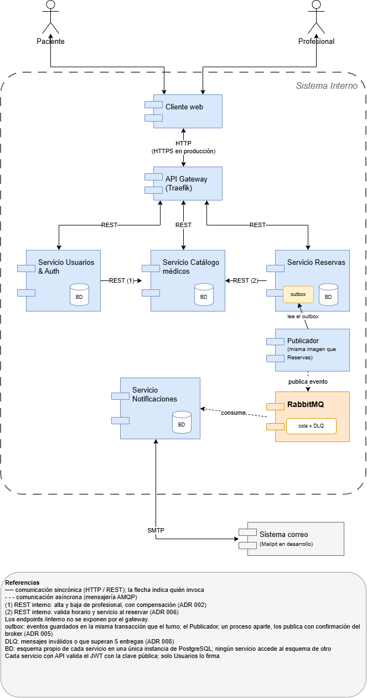

# Arquitectura y justificación de componentes

Microservicios con comunicación síncrona por REST y asíncrona por eventos en
RabbitMQ. Cada servicio es dueño de sus datos en un esquema propio de
PostgreSQL y ninguno accede al esquema de otro.

Editable: [arquitectura.drawio](diagramas/arquitectura.drawio).

## Componentes

| Componente | Tecnología | Responsabilidad | Por qué |
| --- | --- | --- | --- |
| API Gateway | Traefik | Punto de entrada único; enruta por prefijo a cada servicio y no publica los endpoints `/interno` | Descubre los servicios por las etiquetas de Docker; el cliente no conoce las direcciones internas |
| Usuarios | Python + FastAPI | Registro, login, emisión del JWT y perfil (USUARIO, PACIENTE) | Reúne usuarios y autenticación para que el registro de pacientes sea una transacción local; es el único que firma tokens |
| Catálogo | Python + FastAPI | Especialidades, servicios, profesionales y sus horarios (DISPONIBILIDAD) | Es la parte más consultada: se optimiza para lectura y no depende de otros servicios para listar |
| Reservas | Python + FastAPI | Reservar, cancelar, mis turnos y agenda (TURNO); escribe los eventos en su outbox | Es el componente transaccional: decide la concurrencia con restricciones de PostgreSQL |
| Notificaciones | Python + aio-pika | Consumir los eventos de turnos y enviar los avisos por correo (NOTIFICACION). En implementación | Desacoplado por mensajería: si se cae, las reservas siguen funcionando |
| PostgreSQL | PostgreSQL 16 | Persistencia, un esquema y un usuario por servicio | Transacciones y restricciones (índice único parcial, EXCLUDE) que resuelven la concurrencia en la base |
| RabbitMQ | RabbitMQ 3.13 | Exchange `turnos` con los eventos `turno.confirmado` y `turno.cancelado` | Comunicación asíncrona y desacoplada entre Reservas y Notificaciones |
| Correo | Mailpit (desarrollo) | Recibe los mails | Permite ver los avisos sin un proveedor real |
| Cliente web | HTML + JS servido por nginx | Interfaz de pacientes y profesionales. Hoy es solo un esqueleto | Pasa por el gateway como cualquier otro cliente |

## Comunicación entre servicios

| Origen → destino | Mecanismo | Para qué |
| --- | --- | --- |
| Cliente → servicios | REST vía gateway | Todas las operaciones de usuario |
| Usuarios → Catálogo | REST interno | Alta y baja del profesional, con compensación ([ADR 002](decisiones/002-registro-profesional-compensacion.md)) |
| Reservas → Catálogo | REST interno | Validar horario y servicio al reservar ([ADR 006](decisiones/006-copia-franja-en-turno.md)) |
| Reservas → Notificaciones | Eventos por RabbitMQ, desde el outbox | Avisar confirmaciones y cancelaciones ([ADR 005](decisiones/005-outbox-eventos-turno.md)). Hoy los eventos se escriben en el outbox; la publicación y el consumo están en implementación |

El detalle de cada contrato está en [05-comunicacion.md](05-comunicacion.md).

## Decisiones de arquitectura

| ADR | Decisión |
| --- | --- |
| [001](decisiones/001-migraciones-al-arrancar.md) | Las migraciones se aplican al arrancar cada contenedor (pendiente para varias réplicas) |
| [002](decisiones/002-registro-profesional-compensacion.md) | PROFESIONAL vive en Catálogo; el registro de profesional usa compensación |
| [003](decisiones/003-horarios-libres.md) | Cómo marcar horarios libres (propuesta, sin decidir) |
| [004](decisiones/004-copia-nombre-profesional.md) | Copia de nombre y apellido del profesional en Catálogo |
| [005](decisiones/005-outbox-eventos-turno.md) | Outbox transaccional para los eventos de turno |
| [006](decisiones/006-copia-franja-en-turno.md) | Copia de los datos del horario en TURNO |
| [007](decisiones/007-cancelacion-y-estados-de-turno.md) | Plazo de cancelación según quién cancela; FINALIZADO fuera de alcance |
